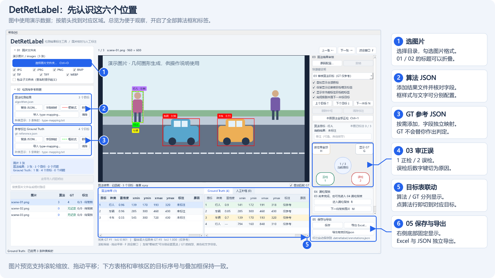
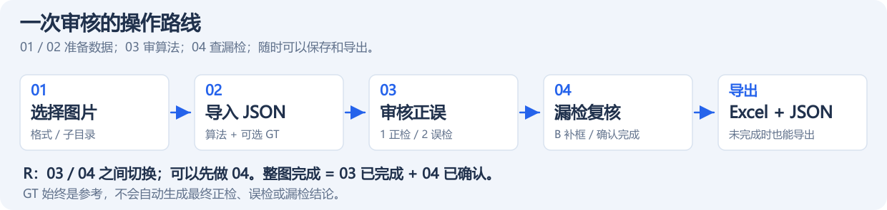

# DetRetLabel

运行在 Windows 上的目标检测结果人工核对工具，使用 Python + Qt（PySide6）实现。导入图片和算法结果 JSON 后，可在图片上查看目标框、种类、置信度，逐个标注正检 / 误检，并人工补充漏检目标。

**[详细使用指南](docs/使用指南.md)**：字段映射、完整标注流程、显示配置、快捷键、报告导出、进度恢复与换机交接。

[下载 Windows 发布版本](https://github.com/H9elix/DetRetLabel/releases/latest) · [GitHub Actions 与发布方法](docs/GitHub发布.md)

## 界面一览



按图中 **1 → 2 → 4** 即可开始审核；**3** 是可选的 GT 参考，**5** 可直接点选目标，**6** 随时导出报告。图片使用生成的演示数据，详细操作见[图文使用指南](docs/使用指南.md)。

## 主要特性

- 支持 JPG、JPEG、PNG、BMP、TIF、TIFF、WEBP，可筛选格式、扫描子文件夹、搜索图片名、缩放和平移。
- 独立导入算法结果和可选的 Ground Truth（GT）；自动建议 JSON 字段映射，也可手动选择，支持像素 `xyxy` / `xywh` 框。
- **03 算法审核**：逐目标选择正检或误检，支持原因选项、自定义原因、备注和本图全部正检。
- 每图的算法 / GT 目标按置信度从高到低显示，同分保持原始顺序，无置信度的排在最后；表格、框序号、审核顺序和报告同步。
- **04 漏检复核**：人工绘制漏检框，或确认无漏检。03 未完成也可先做 04；两步都完成才算整图完成。
- 算法与 GT / 人工补框表并排显示，支持点选查看；GT 同类 / 异类 IoU 候选提供淡色高亮提示，始终由人工判断。
- 可配置框颜色、线型和标签内容；默认保留已审核算法框及标签，可随时关闭；支持 `type-mapping` 种类显示名称、按住临时显示全部算法框、独立显示 GT。
- 自动保存标注及未完成进度，支持撤销、确认后清空本图 / 全部标注，以及复制数据到另一台机器继续标注。
- 复核中途或完成后均可导出 Excel，包含复核概览、图片进度和目标明细。
- 顶部“帮助”菜单显示作者 **H9elix** 和 `BuildYYYYMMDD`，支持离线预览 README、详细使用指南及文档内查找。

## 安装与启动

**直接运行 exe（Windows 64 位，无需安装 Python）：** 在 [Releases](https://github.com/H9elix/DetRetLabel/releases) 下载 single 或 folder 版本。本地构建产物位于 `dist/windows-x64/`。

- 单文件版：双击 `DetRetLabel-single.exe`，复制这一个文件即可运行。
- 文件夹版：双击 `DetRetLabel-folder/DetRetLabel.exe`；exe 与 `_internal` 依赖目录需要一起保留，交接时复制整个文件夹。

两种版本的使用方法相同，也不需要安装 Excel 才能导出报告。单文件版启动时会临时解压依赖，通常比文件夹版稍慢。压缩包、目录结构及重新打包的方法见 [Windows 打包说明](docs/Windows打包.md)。

**从源码运行：** 需要 Windows 10/11 和 64 位 Python 3.10 或更新版本。在项目文件夹中打开 PowerShell，首次使用时执行：

```powershell
python -m venv .venv
.\.venv\Scripts\python.exe -m pip install -r requirements.txt
.\.venv\Scripts\python.exe main.py
```

依赖安装完成后，也可以双击项目中的 [run.bat](run.bat) 启动。

## 快速开始



1. **01 选择图片**：点击“选择图片文件夹”，按需勾选格式；图片在子目录中时勾选“包含子文件夹”。
2. **02 导入结果**：在“算法检测结果”块中添加 JSON，确认图片字段、目标列表、坐标字段、框格式及种类 / 置信度字段。GT 可选，使用另一导入块独立添加。
3. **03 审核算法目标**：按 **1** 标为正检，按 **2** 标为误检。选择误检后，数字键自动切为原因选项，也可输入新原因并按 **Enter** 确认。
4. **04 检查漏检**：算法目标审完会自动进入，也可按 **R** 提前进入。仅在 04 中，按 **B** 在图上拖出漏检框，填写种类、原因和备注。
5. **完成本图复核**：按 **Ctrl+Enter**，或点击“完成漏检复核 / 确认无漏检并完成”。保存成功后会跳到下一张未完成图片；03 尚未完成的图片仍保留未完成标记。
6. **保存与导出**：标注自动保存，**Ctrl+S** 可立即保存；点击标注面板顶部“导出 Excel…”可导出当前进度报告。

**GT 只供参考，不会自动决定正检、误检或漏检。03 中不支持补漏框，需先切到 04。**

标注保存在所选图片目录下的 `.detretlabel/annotations.json`，原始图片和输入 JSON 保留。再次打开同一图片目录，并导入相同算法 JSON、使用相同字段映射，即可继续标注。

## 常用快捷键

| 按键 | 用途 |
| --- | --- |
| `1` / `2` | 正检 / 误检；选择原因时复用数字键 |
| `Enter` | 确认原因；原因留空时跳过 |
| `↑` / `↓` | 上一个 / 下一个目标 |
| `←` / `→` | 上一张 / 下一张图片 |
| `R` / `B` | 切换 03 / 04；仅在 04 中补漏框 |
| 按住 `H` | 临时显示全部算法框，松开恢复 |
| `G` | 显示 / 隐藏全部 GT 框 |
| `Ctrl+1` | 本图算法目标全部标为正检 |
| `Ctrl+Enter` | 完成本图 04 漏检复核 |
| `Ctrl+S` / `Ctrl+Z` | 保存 / 撤销 |

以上为默认按键；完整说明与自定义方法见 [详细使用指南](docs/使用指南.md#7-快捷键与原因配置)。

## 先用测试素材体验

本地已有测试包时，在 01 选择 `test_data/coco128/images`，在 02 导入 `test_data/coco128/01_results_xyxy.json`，确认框格式为 `xyxy`。预期匹配 128 张图片、929 个目标。

GitHub 源码只保留[测试包说明](test_data/coco128/开始测试.md)、映射和生成脚本，不上传下载素材或个人标注。从 GitHub 克隆后可按[素材准备方法](test_data/README.md)生成测试包。这些框来自数据集标注，置信度为模拟值，适合测试工具操作。更多 JSON 格式样例见 [examples](examples/)。
