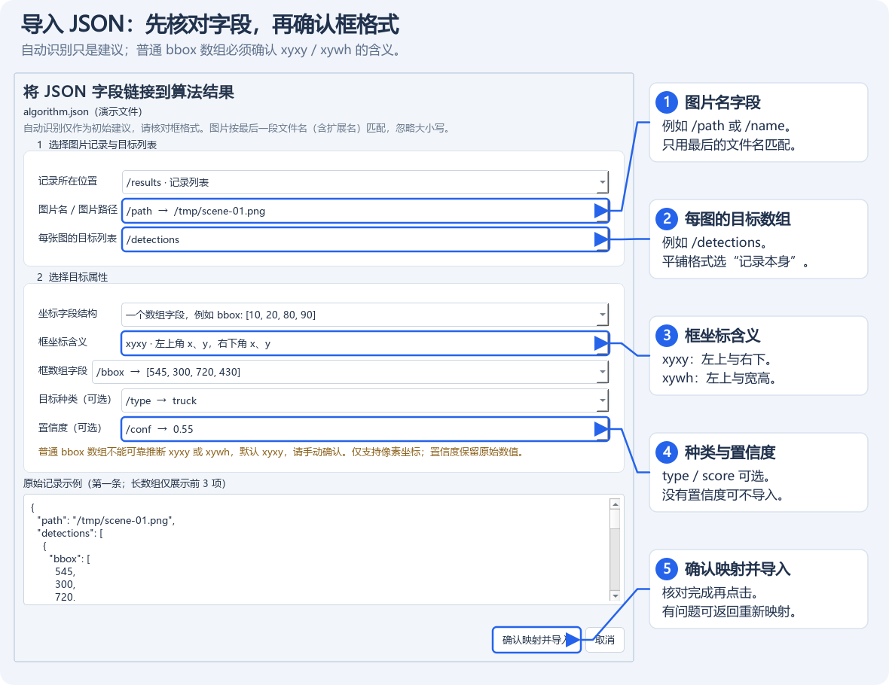
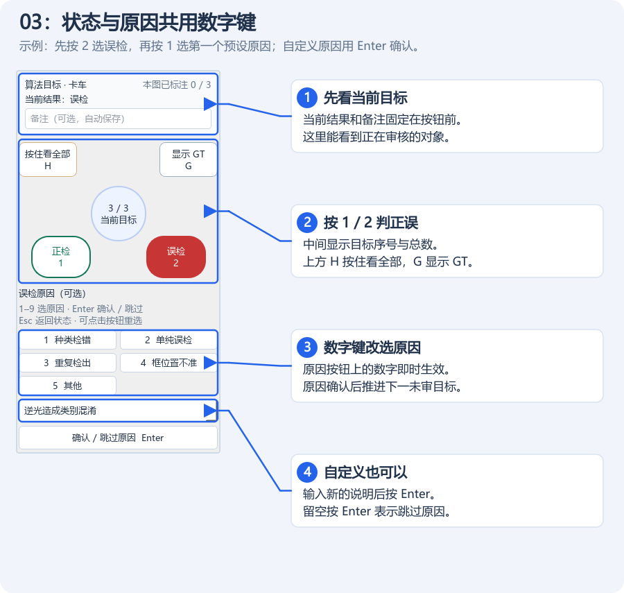
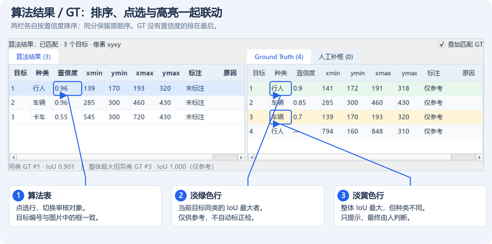
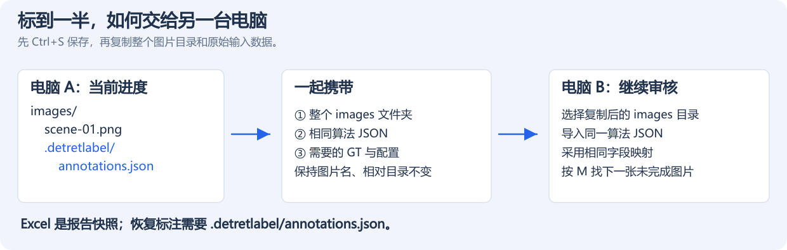

# DetRetLabel 详细使用指南

[返回 README](../README.md)

DetRetLabel 用于核对已有目标检测结果。你提供图片和算法结果 JSON，工具负责显示框、辅助查看参考标注，并记录测试人员的判断；工具本身不运行检测算法。

## 目录

1. [安装与启动](#1-安装与启动)
2. [认识界面与准备图片](#2-认识界面与准备图片)
3. [导入算法结果与 GT](#3-导入算法结果与-gt)
4. [审核算法结果：03](#4-审核算法结果03)
5. [检查与补充漏检：04](#5-检查与补充漏检04)
6. [框、标签与参考目标显示](#6-框标签与参考目标显示)
7. [快捷键与原因配置](#7-快捷键与原因配置)
8. [保存、恢复与换机交接](#8-保存恢复与换机交接)
9. [导出 Excel 复核报告](#9-导出-excel-复核报告)
10. [清除、删除与清空标注](#10-清除删除与清空标注)
11. [JSON 格式示例与匹配规则](#11-json-格式示例与匹配规则)
12. [常见问题](#12-常见问题)
13. [测试素材与当前范围](#13-测试素材与当前范围)

## 1. 安装与启动

### 1.1 使用打包版本

Windows 64 位打包产物位于 `dist/windows-x64/`，无需预先安装 Python、Qt 或 Excel：

- **单文件版**：直接双击 `DetRetLabel-single.exe`，换机时仅复制这个 exe。默认原因配置也已内置，启动时自动解压所需运行库到系统临时目录。
- **文件夹版**：在 `DetRetLabel-folder` 中双击 `DetRetLabel.exe`。`_internal` 内是运行库、Qt 插件和默认配置，必须与 exe 放在一起；不能只拷走这个小 exe。

首次收到 ZIP 时先完整解压，再启动。两种版本功能、快捷键、报告格式及进度保存位置一致，可以接续同一份标注数据。个人图片、输入 JSON 和进度文件需要另外携带。

打包目录和重新构建方法见 [Windows 打包说明](Windows打包.md)。

### 1.2 从源码启动

运行环境：Windows 10/11、64 位 Python 3.10 或更新版本。

将项目放在本地文件夹，在该文件夹中打开 PowerShell，执行：

```powershell
python -m venv .venv
.\.venv\Scripts\python.exe -m pip install -r requirements.txt
.\.venv\Scripts\python.exe main.py
```

前两条命令通常只在首次准备环境时执行。之后可双击项目根目录的 [run.bat](../run.bat)，或使用最后一条命令启动。启动器优先使用项目中的 `.venv`，缺少依赖时会显示安装命令。

准备以下数据即可开始：

| 数据 | 是否必需 | 用途 |
| --- | --- | --- |
| 图片文件夹 | 是 | 测试集图片，也是标注进度的保存位置 |
| 算法结果 JSON | 审核算法目标时需要 | 图片名、目标框和可选的种类、置信度 |
| GT JSON | 可选 | 显示已有参考框，供人工核对 |
| type-mapping 文本 | 可选 | 将种类代号显示为易读名称 |
| 原因 / 快捷键配置 JSON | 可选 | 自定义误检、漏检原因及操作按键 |

当前提供一个算法 JSON 来源和一个 GT JSON 来源，每份文件可以包含多张图片的结果。也可以仅导入 GT，或先只打开图片进行漏检复核。

## 2. 认识界面与准备图片

### 2.1 界面分区


图中编号依次对应：**1 图片目录、2 算法 JSON、3 可选 GT、4 正误审核、5 联动目标表、6 Excel 导出**。所有截图使用生成的演示图片与临时数据，不代表真实算法效果；其中 GT 的异类候选是为演示提示颜色而特意设置的。

| 区域 | 主要操作 |
| --- | --- |
| 左侧 01 图片文件夹 | 选择图片目录、格式和是否扫描子目录 |
| 左侧 02 检测与参考数据 | 分别导入算法 / GT JSON，配置字段、框样式和种类映射 |
| 左侧图片列表 | 搜索、切换图片，查看算法 / GT 数量和人工进度 |
| 中间图片预览 | 查看叠加框，滚轮缩放，拖动平移，按 F 适应窗口 |
| 中间下方左表 | 查看、点选算法目标，切换到该目标审核 |
| 中间下方右表 | 在 Ground Truth / 人工补框页签间切换，点选参考查看 |
| 右侧标注面板 | 03 正误审核、04 漏检复核、原因、备注、保存和导出 |
| 顶部帮助菜单 | 查看作者 H9elix、版本和 BuildYYYYMMDD，预览 README 与详细使用指南 |

01、02 的标题可展开 / 折叠。导入数据后可将它们折叠，让图片列表显示更多内容；小窗口中的设置区和标注面板可以滚动。

拖动图片与结果表之间、两张结果表之间的分隔条，可以调整区域大小。下方匹配提示固定为一行，额外高度留给表格。

在“帮助”中点击“预览 README.md…”或“详细使用指南…”，会打开独立的只读帮助窗口，不需要退出当前标注。两份文档可通过页签或链接切换，目录支持跳转，`Ctrl+F` 可定位到查找框，输入文字后按 Enter 逐处查找。打包版本内置这些文档，不需要联网或另带 Markdown 文件。

帮助菜单和预览窗口同时显示作者 **H9elix**、程序版本和打包标识，例如 `Build20261024` 表示 2026 年 10 月 24 日打包。打包标识在构建时固定，之后启动程序不会随当天日期变化。

### 2.2 选择图片

1. 在 01 点击“选择图片文件夹”，或按 `Ctrl+O`。
2. 勾选需要标注的格式：JPG、JPEG、PNG、BMP、TIF、TIFF、WEBP。
3. 图片位于子文件夹时，勾选“包含子文件夹”；默认仅扫描直接选择的目录。
4. 扫描完成后，点击图片列表中的行查看图片。

图片按自然顺序排列，例如 `2.jpg` 在 `10.jpg` 之前。搜索框用于筛选图片名；上一张 / 下一张和待处理图片跳转会遵循当前搜索范围。

格式筛选、递归设置决定哪些图片被加载，搜索只隐藏列表中的部分行。这个区别也影响报告范围，见[报告导出](#9-导出-excel-复核报告)。

## 3. 导入算法结果与 GT

### 3.1 添加 JSON 与确认字段

展开 02，在“算法检测结果”块中点击“添加 JSON”，或按 `Ctrl+J`。选择文件后，在字段映射窗口核对下列项目，最后点击“确认映射并导入”。



优先核对图中的 **1 图片字段、2 目标数组、3 坐标格式**。例如 `/tmp/scene-01.png` 会按最后的 `scene-01.png` 与图片目录匹配；框数组名为 `bbox` 并不代表一定是 `xyxy`。

| 映射项目 | 应选择的内容 | 常见示例 |
| --- | --- | --- |
| 记录所在位置 | 存放图片记录的数组或对象 | JSON 根节点、`/results`、`/payload/frames` |
| 图片名 / 图片路径 | 当前记录中指向图片的字段 | `/path`、`/name`、`/file_name` |
| 每张图的目标列表 | 每张图的目标数组；平铺记录则选择对应模式 | `/detections`、`/objects` |
| 坐标字段结构 | 四元素数组，或四个独立字段 | `/bbox`，或 `/xmin` 等 |
| 框坐标含义 | 像素 xyxy 或左上角形式的 xywh | 见下方说明 |
| 目标种类 | 名称或数字代号；也可不导入 | `/type`、`/class_id`、`/label` |
| 置信度 | 原始置信度字段；也可不导入 | `/conf`、`/score`、`/confidence` |

工具会建议常见字段，但仍应核对坐标格式：

- **xyxy**：`[xmin, ymin, xmax, ymax]`，例如 `[100, 80, 340, 280]`。
- **xywh**：`[左上角x, 左上角y, 宽, 高]`，同一个框写为 `[100, 80, 240, 200]`。

普通 `bbox` 数组无法可靠判断是哪种格式，默认建议 `xyxy`。这里的 `xywh` 不是中心点坐标。当前只支持像素坐标，不会把归一化坐标自动换算为像素。

字段中的 `/meta/path` 表示嵌套对象 `meta` 下的 `path`。字段名本身包含 `/` 或 `~` 时，界面使用 `~1`、`~0` 转义。完整样例见[第 11 节](#11-json-格式示例与匹配规则)。

### 3.2 添加 GT 参考数据

在“参考标注 Ground Truth”块中独立添加 JSON，或按 `Ctrl+Shift+J`，重复映射过程。两份 JSON 的结构和框格式可以不同。GT 没有置信度时，选择不导入置信度。

**GT 只供人工观察，不进入算法审核队列，不会自动产生正检、误检或最终漏检结论。**

每个导入块均可独立替换 JSON、修改“字段映射”或“移除”数据。移除输入来源不等于清空已保存的人工标注。

更换算法内容或字段映射后，目标身份可能改变，需要重新核对；重新导入相同内容和映射可恢复对应版本标注。更换 GT 不改变人工结论。

### 3.3 检查导入问题

查看左侧匹配统计，存在问题时点击“查看导入问题明细”。报告区分算法 / GT 来源，选中行后可按 `Ctrl+C` 复制。

常见问题包括图片未匹配、同名歧义、缺少已映射字段、无效坐标。部分目标有问题时，其余有效目标仍可导入；取消导入或文件读取失败会保留原有来源。

“JSON 无本图记录”和“明确的空目标列表”含义不同，二者都不会自动变成漏检结论。

### 3.4 种类显示映射 type-mapping

如果 JSON 使用 `0`、`typeA` 等代号，可在对应 JSON 块点击“导入 type-mapping…”。算法与 GT 可配置不同文件。

使用 UTF-8 文本，每行一个 `代号:显示名称`：

```text
typeA:行人
typeB:汽车
0:行人
1:汽车
```

- 支持 UTF-8 BOM、空行和以 `#` 开头的注释行，也兼容中文冒号。
- 每行以第一个冒号分隔，显示名称内部可以含冒号。
- 代号精确匹配，区分大小写；数字种类 `0` 可匹配 `0:行人`，字符串 `001` 保留前导零。
- 未配置的种类显示原值；没有种类字段时不补造种类。
- 空代号、空名称、重复代号或缺少冒号会提示错误并保留当前映射。

映射影响图片标签、目标表、目标卡片及 GT 同类比较，Excel 同时保留原始种类和显示名称。它不会改写原始 JSON、目标身份或已有标注。点击“清除”恢复原始显示。

映射内容会在本机保存，修改文本后需重新导入。可参考[通用映射样例](../examples/type-mapping.txt)，或用[测试集中文映射](../test_data/coco128/type-mapping.txt)体验。

## 4. 审核算法结果：03


### 4.1 标注单个目标

在步骤下拉框中选择“03 审核算法目标”，或从 04 按 `R` 返回。

每张图的算法目标按置信度从高到低审核，同分保持 JSON 原始顺序。缺少置信度或值为 `null` 的目标保留，排在数值目标后面，彼此保持原始顺序；全部没有置信度或未选择置信度映射时，保持原始顺序。非数字、无穷大等无效置信度仍作为导入问题处理。

下方“算法结果”表、图上目标序号、当前目标计数及 Excel 明细使用相同次序。“GT”表及其叠加框独立按同样规则排序；点选 GT 和自动匹配高亮均对应排序后的行及框。人工补框保持原来的添加次序。悬停表格单元格可查看目标在原始 JSON 中的位置。

排序只在导入 / 重新匹配 JSON 时计算一次，切图使用缓存。原始 JSON、目标标识和既有标注关联不变；重新导入原文件后，已有结论仍会对应原来的目标。

1. 选择图片，使用 `↑` / `↓` 或点击下方左表选中算法目标。
2. 根据图片内容，点击正检 / 误检按钮，或按 `1` / `2`。
3. 误检后，数字键自动复用为原因选项，最多提供前 9 项快捷原因。点击原因按钮或按相应数字会确认原因。
4. 也可在原因框选择已有项、输入自定义内容，再按 `Enter` 确认；原因留空时按 `Enter` 跳过。
5. 按需填写当前目标的备注。

例如：按 `2` 选择误检，再按 `1` 选择第一个误检原因。第二次按 `1` 是选择原因，不是把目标改为正检。



图中示范的是“卡车”类别误检：先判断正误，再确认原因。**预设原因直接点按钮或按数字；自定义原因输入后按 Enter**，两种方式都能完成本目标的原因选择。

误检原因未确认时，该目标显示“原因待确认”，03 仍未完成。按 `Esc` 可收起原因区，保留状态和草稿，但不确认原因；选回该目标后可继续。

默认完成当前目标后，推进到本图下一个未标目标。可取消“完成后到本图下一未标目标”，按自己的节奏切换。本图算法目标全部审完后，通常自动进入 04；最后一个误检需先确认或跳过原因。

**03 没有补漏框按钮，按 B 也不会开启绘框或自动进入 04。**

### 4.2 本图算法全部正检

点击“本图算法全部正检”，或按 `Ctrl+1`，会将本图所有算法目标设为正检，清除误检原因和待确认草稿，保留备注，并进入 04。

这个操作也会改写本图已经标为误检的算法目标；GT 和人工漏检框不受影响。可用一次 `Ctrl+Z` 整体撤销。

## 5. 检查与补充漏检：04

### 5.1 进入复核

算法目标审完后会自动进入 04，也可通过步骤下拉框、`R` 或“进入漏检复核”手动进入，**不要求先完成 03**。已有结论、备注和未确认的误检原因草稿会保留。

进入 04 后临时显示全部算法框，退出时恢复之前的算法显示选项。GT 全量显示仍由“显示 GT”控制；手动点选、自动匹配显示的参考框遵循各自设置。


图中右侧行人没有算法框，由测试人员在 04 中补成紫色框。检查完成后点击图中 **2**，或按 `Ctrl+Enter`；是否算整图完成仍取决于 03 和 04 两步的实际状态。

### 5.2 补充漏检目标

1. 在 04 中按 `B`，或点击“在图上补漏框”。
2. 在图片上按住左键拖出漏检目标框。
3. 输入目标种类，可留空。
4. 选择漏检原因，或输入新原因后按 `Enter` 确认；留空可跳过。
5. 按需填写备注，继续检查其他漏检。

绘框时可按 `Esc` 取消。人工框自动记为漏检，显示在右侧“人工补框”页签中，种类按输入内容显示。录入漏检原因后，请先确认再切换目标或交接。

人工框始终显示，使用紫色，线型及标签选项跟随 02 中 GT 的框样式，默认紫色虚线。修改 GT 颜色不会把人工框改成 GT 的颜色。

### 5.3 查看与修改已有补框

单击人工补框行或图上的人工框，只查看、加粗所选参考框，保留当前审核目标和原因编辑状态，与单击 GT 相同。

需要修改原因或备注时，**双击人工补框行**，显式进入 04 编辑该框。随后可选择新原因、修改备注，或点击“删除补框”删除当前正在编辑的人工框。新增补框后直接进入新框的原因编辑。

### 5.4 完成 04 与图片完成状态

检查完毕后，按 `Ctrl+Enter`，或点击“完成漏检复核”；没有人工补框时，按钮为“确认无漏检并完成”。

按钮只确认 **04**，不会替未审算法目标选择正检，也不会确认 03 的原因草稿。保存成功后，自动进入当前搜索范围内的下一张未完成图片；没有其他待处理图片，而本图 03 未完成时，会返回本图 03。保存失败时停留本图。

| 03 算法审核 | 04 漏检复核 | 整张图片 |
| --- | --- | --- |
| 未完成 | 待复核 | 未完成 |
| 已完成 | 待复核 | 未完成 |
| 未完成 | 已完成 | 未完成，列表显示“03未完成 · 04已完成” |
| 已完成 | 已完成 | 复核完成 |

算法没有检出目标时，`0/0` 不代表图片完成，仍需进入 04 检查并显式确认。按 `M` 可查找下一张未完成图片。

修改算法判定、原因，增加 / 清除 / 删除人工漏检等，会使受影响图片重新待复核；已有标注和补框保留，撤销可恢复之前的完成状态。单纯修改备注或显示选项不影响完成状态。主动点击“重新复核”进入 04，也会将该图的 04 恢复为待确认。

## 6. 框、标签与参考目标显示

### 6.1 框样式和标签内容

在 02 对应来源点击“框样式”，可配置颜色、实线 / 虚线 / 点线 / 点划线 / 双点划线，以及是否显示种类、置信度、目标序号、来源名称。

对话框实时预览，点击“确定”才应用；“恢复默认”用于恢复当前来源的默认样式。算法与 GT 分别保存设置，也可在导入 JSON 前预设。

| 来源 | 默认颜色 | 默认线型 |
| --- | --- | --- |
| 算法结果 | 红色 `#FF0000` | 实线 |
| GT | 绿色 `#00FF00` | 虚线 |
| 人工补框 | 紫色 `#B77AFF` | 跟随 GT，默认虚线 |
| 整体 IoU 最大但异类的 GT 候选 | 黄色 `#FFFF00`；颜色过近时自动换色 | 跟随 GT |

缺少的标签字段自动略过，例如没有置信度的 GT 不显示分数。全部关闭文字选项时仅显示框。绘制会裁剪到图片范围，原始坐标保留；缩放时文字和线宽保持可读，悬停可查看完整信息。

### 6.2 显示开关的区别

| 控件 | 作用范围与行为 | 默认状态 |
| --- | --- | --- |
| 叠加显示全部目标 | 显示本图全部算法框；关闭时只显示当前算法目标。04 中临时开启 | 每次启动关闭 |
| 显示非当前标注目标的标签 | 控制其他可见算法框的标签，包含已标与未标目标，也影响临时显示 | 每次启动关闭 |
| 按住看全部 / 按住 H | 临时显示全部算法框，松手或窗口失焦后恢复 | 松开恢复 |
| 显示 GT / G | 切换本图全部 GT 框及标签 | 每次启动关闭 |
| 叠加匹配 GT | 显示自动匹配候选，独立于全量 GT 开关 | 初始关闭，之后记住设置 |

“显示非当前标注目标的标签”可独立勾选，不要求先开启“叠加显示全部目标”。它不控制 GT 和人工框的标签，这些标签由 GT 框样式中的文字选项决定。

### 6.3 点选目标与 IoU 提示



例如图中算法第 1 行为“行人”：GT 第 1 行以淡绿色提示同类最大 IoU，GT 第 3 行以淡黄色提示整体最大但异类的候选。**GT 的行号属于 GT 自己的排序**，不必与算法行号相同；按匹配高亮和实际框的位置核对。

左表点击算法行会切换到该目标审核，即使原来处于 04。右表 GT / 人工补框单击只作参考查看；切换右侧页签时，按该页当前行联动查看。换算法目标或切图后清除手动参考选择。

审核算法目标时，GT 表自动提供以下提示，表格下方列出目标序号和 IoU（两框交并比）：

- **淡绿色行**：同类 GT 中 IoU 最高者。
- **淡黄色行**：全部 GT 中 IoU 最高者，且该目标与算法目标种类不同。

两行可能同时出现。种类按各自 type-mapping 后的显示名称比较，未映射时使用原始代号的文字形式；缺失种类不视为同类。只提示 `IoU > 0` 的候选，同分按 GT 原始顺序取第一项。

勾选“叠加匹配 GT”后，同类候选使用已配置的 GT 样式；整体最大但异类的候选用黄色或另一种与算法 / GT 明显不同的颜色，保留 GT 线型。匹配框绘制在当前算法框上层，便于看清重合轮廓。

匹配在后台按当前目标计算，连续切目标时合并为最新请求，切图后忽略旧结果。**提示不写入人工结论，也不参与完成状态或正误漏统计。**

## 7. 快捷键与原因配置

### 7.1 默认快捷键

| 按键 | 操作 |
| --- | --- |
| `Ctrl+O` | 选择图片文件夹 |
| `Ctrl+J` / `Ctrl+Shift+J` | 添加算法 / GT JSON |
| `1` / `2` | 03 正检 / 误检；原因阶段选第 1 / 2 项原因 |
| `3`～`9` | 原因阶段选择对应原因，03 状态阶段不作漏检判定 |
| `Enter` | 确认原因，空内容表示跳过；已标目标可继续推进或进入复核 |
| `Esc` | 取消绘框或收起原因区，保留已选状态和误检草稿 |
| `↑` / `↓` | 当前阶段的上一个 / 下一个目标 |
| `←` / `→` | 上一张 / 下一张可见图片 |
| `N` | 查找下一个未标目标，可继续查找其他可见图片的算法目标 |
| `M` | 下一张未完成图片，包含零检出图片 |
| `R` | 进入 04 / 返回 03 |
| `B` | 仅在 04 中开启 / 关闭补漏框模式 |
| `Ctrl+Enter` | 显式完成本图 04 |
| 按住 `H` | 临时显示全部算法框，松开恢复 |
| `G` | 显示 / 隐藏全部 GT |
| `Ctrl+1` | 本图算法目标全部正检，并进入 04 |
| `Backspace` | 清除当前目标标注，人工框本身保留 |
| `Ctrl+Z` / `Ctrl+S` | 撤销 / 立即保存 |
| `F` | 图片适应窗口 |

在原因、备注、搜索等输入框中，普通字符键用于输入，不触发目标分类；原因和备注框中的 Enter 可用于确认。长按分类数字键不会连续标注多个目标。悬停“快捷键说明”可查看当前配置的按键。

### 7.2 配置原因与按键

点击标注面板顶部“原因配置…”，选择 JSON。默认文件见 [config/reasons.json](../config/reasons.json)。可以复制后修改，或只填写要覆盖的按键：

```json
{
  "version": 1,
  "reasons": {
    "false_positive": ["种类检错", "单纯误检", "重复检出"],
    "false_negative": ["完全未检出", "遮挡或截断", "目标过小"]
  },
  "auto_advance": true,
  "shortcuts": {
    "draw_missed": "B",
    "toggle_ground_truth": "G",
    "hold_all_algorithm": "H",
    "all_positive": "Ctrl+1",
    "start_review": "R",
    "finish_review": "Ctrl+Return",
    "next_review_image": "M"
  }
}
```

`false_positive` 为误检原因，`false_negative` 为漏检原因。前 9 项可用数字键选择，其余可在下拉框选择；配置外的新原因也可输入。`auto_advance` 控制目标间自动推进，不关闭“本图算法审完后进入 04”的行为。

`decision_1` / `decision_2` 控制正检 / 误检，`decision_1` 至 `decision_9` 在原因阶段复用。未填写的操作沿用默认值。配置中用 `Return` 表示 Enter、`Escape` 表示 Esc，可使用单键或组合键。

按键不可重复，也不能与 `Ctrl+O`、`Ctrl+J`、`Ctrl+Shift+J`、`F` 等导入 / 预览按键冲突。格式错误时保留现有配置。

## 8. 保存、恢复与换机交接

### 8.1 进度保存位置

进度自动保存在 **01 中选择的图片根目录** 下：

```text
images/
  0001.jpg
  0002.png
  .detretlabel/
    annotations.json
```

保存人工结论、原因、备注、算法误检原因草稿及待确认标记、人工漏检框和图级复核状态。**未完成图片也会保存，不需要先完成 03 或 04。**

按 `Ctrl+S` 可立即保存。关闭窗口和切换图片目录前也会保存；失败时提示并保留内存修改、阻止关闭。原图、算法 JSON、GT JSON 不被改写。

当前标注文件为 version 2，可读取旧版 version 1。历史 GT 人工标记保留为参考历史，不计入当前决策；旧算法框上的漏检状态显示为“旧漏检，待重审”，需重新判定正误。

### 8.2 下次继续标注

1. 重新打开工具，选择同一个图片根目录。
2. 导入相同算法 JSON，使用相同字段映射和框格式。
3. 按需导入 GT、显示映射和原因配置。
4. 查看进度，按 `M` 找下一张未完成图片，或按 `N` 找未标目标。

工具恢复标注进度，但不保存精确的当前光标位置和跨会话撤销历史。修改算法内容、目标顺序或字段映射可能产生新的目标身份；旧记录保留，但不会随意套到新目标上。

### 8.3 换电脑或交给别人接着标注



图中蓝色的 `.detretlabel/annotations.json` 必须跟随图片目录一起复制；仅发送 Excel 报告不能继续恢复审核。

1. 原标注人员按 `Ctrl+S`，确认保存成功后关闭工具。漏检原因文字先按 Enter 确认；未确认的算法误检原因会以草稿保留。
2. 复制整个图片目录，务必包含 `.detretlabel` 子目录，并保持图片名及相对目录不变。
3. 一并提供原始算法 JSON，以及需要的 GT、type-mapping、原因 / 快捷键配置。
4. 新机器准备相同版本工具并安装依赖，选择复制后的图片根目录，导入同一算法 JSON、使用相同字段映射，即可继续。

例如，新机器应在 01 选择下列 `images` 文件夹：

```text
交接包/
  images/
    0001.jpg
    0002.png
    .detretlabel/
      annotations.json
  algorithm.json
  ground_truth.json
  type-mapping.txt
  reasons.json
```

盘符、图片根目录绝对位置和 JSON 存放位置可以改变；算法 JSON 内容、目标顺序应保持一致。格式筛选和递归设置也应一致，以加载相同图片。

框样式、显示映射、配置文件路径等界面设置保存在当前电脑的 Qt 设置中，不在进度文件里，换机后按需重新配置。当前支持顺序交接，不支持多人同时编辑后的自动合并。Excel 用于查看报告，不能恢复标注进度。

## 9. 导出 Excel 复核报告

加载图片后，点击标注面板顶部“导出 Excel…”，选择保存位置。复核过程中和全部完成后都可以导出 `.xlsx`。

| 工作表 | 包含内容 |
| --- | --- |
| 复核概览 | 整图及 03 / 04 进度，正检、误检、未审核、原因待确认、人工漏检统计，按种类汇总和输入来源 |
| 图片进度 | 每图目标数、结论数量、整图状态、03 状态、04 状态、04 完成时间、原因待确认数、算法输入状态、GT 参考框数 |
| 目标明细 | 当前算法目标及人工补框的坐标、原始 / 显示种类、原始置信度、结论、原因、草稿、备注、来源和两步状态 |

范围是当前格式 / 递归设置下的 **全部已加载图片**，不受图片名称搜索影响。未完成图片列出实际进度；03 未完成、04 已完成时，不计为整图完成。

GT 只统计参考框数量，不作为最终正误漏目标明细；旧算法版本的历史目标不计入当前报告。草稿与已保存原因分列，导出不会确认原因、完成图片或跳转目标。算法误检草稿离开当前图片后仍保留为待确认。

报告是导出时的静态快照，后续修改需重新导出。若目标文件正在 Excel 中打开导致无法替换，关闭该文件后重试；保存失败时保留原有报告。

## 10. 清除、删除与清空标注

| 操作 | 影响范围 |
| --- | --- |
| 清除标注 / Backspace | 清除当前目标的结论、原因、草稿和备注；人工框本身保留 |
| 删除补框 | 删除当前正在编辑的人工框及其标注；先双击相应人工补框行进入编辑 |
| 清空本图标注 | 清空本图全部结论、原因、备注、人工框、复核状态及对应历史记录 |
| 清空全部标注 | 清空当前图片目录保存的整个集合，包括搜索隐藏、格式 / 递归筛选外、已不再加载图片的历史记录 |

两个“清空”按钮位于标注面板底部，操作前确认，默认取消。清空后立即保存，返回本图 03，保留图片和缩放位置。原图、输入 JSON 和显示配置保留。

`Ctrl+Z` 撤销最近操作，一次可恢复整次“全部正检”或整次清空。撤销历史仅本次会话有效；修改过快捷键时，使用自己的按键。

## 11. JSON 格式示例与匹配规则

### 11.1 每张图一个目标列表

推荐使用以下结构，示例采用 `xyxy`：

```json
{
  "results": [
    {
      "path": "/tmp/0001.jpg",
      "detections": [
        {"bbox": [100, 80, 340, 280], "type": "car", "conf": 0.95}
      ]
    },
    {"path": "/tmp/0002.png", "detections": []}
  ]
}
```

| 映射项目 | 选择值 |
| --- | --- |
| 记录所在位置 | `/results` |
| 图片名 / 图片路径 | `/path` |
| 每张图的目标列表 | `/detections` |
| 坐标结构 / 框字段 | 数组 / `/bbox` |
| 框格式 | `xyxy` |
| 种类 / 置信度 | `/type` / `/conf` |

文件样例：[results_grouped.json](../examples/results_grouped.json)。该文件也包含一个不存在的图片名，方便查看未匹配提示。

### 11.2 每条记录一个目标

```json
[
  {"name": "0001.jpg", "xmin": 100, "ymin": 80, "xmax": 340, "ymax": 280, "type": "car", "score": 0.95},
  {"name": "0001.jpg", "xmin": 400, "ymin": 120, "xmax": 470, "ymax": 300, "type": "person", "score": 0.82}
]
```

选择 JSON 根节点、图片字段 `/name`、平铺目标记录、四个独立坐标字段及 `xyxy`。种类 `/type`，置信度 `/score`。

文件样例：[results_flat.json](../examples/results_flat.json)。

### 11.3 图片名作为字典键

```json
{
  "0001.jpg": [{"xywh": [100, 80, 240, 200], "label": "car", "confidence": 0.95}],
  "0002.png": []
}
```

选择以图片名为键的结构，图片字段使用字典键，框字段 `/xywh`，框格式 `xywh`，种类 `/label`，置信度 `/confidence`。

文件样例：[results_xywh.json](../examples/results_xywh.json)。

### 11.4 图片名匹配和数据校验

按最后一段文件名匹配：`/tmp/0001.jpg` 和 `C:\algorithm\0001.jpg` 均匹配图片目录中的 `0001.jpg`。其他路径信息不参与匹配。

- 忽略文件名大小写，保留扩展名；`0001.jpg` 不匹配 `0001.png`。
- 不同子目录存在同名图片时报告歧义，不随意选一张。
- 被格式筛选排除的图片不匹配；缺少记录和明确空目标数组分别显示。
- 框宽、高必须为正，坐标必须有限；允许越界或负坐标，绘制时裁剪，原值保留。
- 种类和置信度可不导入。已选择种类字段后，缺失该字段的目标列为问题；置信度字段缺失或为 `null` 时保留目标，以“—”显示并排在数值目标之后。
- 置信度保留原始尺度，例如 `0.9` 或 `90`，不自动百分化。
- 图片按原始像素方向显示，不自动应用 EXIF 旋转，以保持坐标对应。
- JSON 使用 UTF-8 或 UTF-8 BOM；完全空的结果也可导入，无需为不存在的目标指定框字段。

## 12. 常见问题

### 导入 JSON 后没有框

先检查文件名和扩展名、格式筛选、是否扫描子目录及“查看导入问题明细”。再检查是否选中了算法目标；默认只显示当前算法框。GT 默认关闭，可按 G 显示全部，或单击 GT 行查看一个参考框。

### 框大小或位置明显不对

在来源块点击“字段映射”，核对 `xyxy` / `xywh`、四字段顺序和是否为像素坐标。尤其注意 `xywh` 的 x、y 必须为左上角，不能直接使用 YOLO 中心点或归一化坐标。

### 选择误检后，03 为什么仍未完成

原因还待确认。选择原因，或将输入框留空后按 Enter 跳过。Esc 只收起原因区，不表示确认；也可以先做 04，之后回来处理。

### 03 中按 B 为什么不补框

补框只在 04 中可用。按 R 或通过步骤下拉框进入 04，再按 B 绘框。

### 确认无漏检后，图片为什么仍未完成

该按钮确认的是 04。03 还有未审算法目标或未确认原因时，整图仍未完成。查看两步状态，返回 03 继续审核。

### 改一个算法结论后，04 为什么重新待复核

判定或漏检框变化后，需要重新确认该图的漏检复核。原有人工框、原因和其他标注仍保留；单纯修改备注不会触发这个变化。

### 点选人工补框后，仍在编辑原来的目标

单击用于参考查看，与 GT 相同，不切换审核对象。双击人工补框行才进入该框的原因 / 备注编辑。

### 重新打开或换机后看不到进度

确认选择原来的图片根目录，其中包含 `.detretlabel/annotations.json`，并导入同一算法 JSON、选择相同映射和框格式。不要只复制 Excel；同时核对相对目录、文件名、格式筛选和递归设置。

### 导出或保存失败

关闭正在打开的同名报告，检查目录是否可写、磁盘空间是否足够，再重试。标注保存失败时先保持工具打开，按 Ctrl+S 重试，内存修改仍保留。

## 13. 测试素材与当前范围

### 13.1 用自带测试集体验

[COCO128 测试包](../test_data/coco128/开始测试.md)包含 128 张真实图片、929 个数据集目标框和多种格式样例。源码仓库不提交下载数据；从 GitHub 克隆后，可按[素材准备方法](../test_data/README.md)生成，再将下面的 `coco128` 替换为生成目录名。

1. 01 选择 `test_data/coco128/images`。
2. 02 导入 `test_data/coco128/01_results_xyxy.json`。
3. 核对 `/results`、`/path`、`/detections`、`/bbox`、`xyxy`、`/type`、`/conf`，预期 128 张图片、929 个目标、0 条问题。
4. 可选导入 `ground_truth.json`，不导入置信度；可选导入同目录 `type-mapping.txt` 查看中文种类。
5. 审核几个目标，提前进入 04 补框并导出报告，核对未完成图片的两步状态。

测试置信度为模拟值，`05_simulated_detection_errors.json` 中的误漏检为人工注入，适合验证工具操作。数据来源、许可和更多场景见测试包说明。

### 13.2 当前范围

支持常见图片、上述 JSON 结构和像素轴对齐框。当前不直接支持 COCO `image_id` 跨表关联、YOLO 文本导入、归一化坐标、中心点形式 xywh 或旋转框，可先转换为本文格式。

标注以独立 JSON 保存，可另行导出 Excel；当前没有将人工结果回写合并到原算法 JSON、从 Excel 恢复进度或一键交接打包功能。

如需验证项目代码，可在项目目录运行：

```powershell
.\.venv\Scripts\python.exe -m unittest discover -v
```
